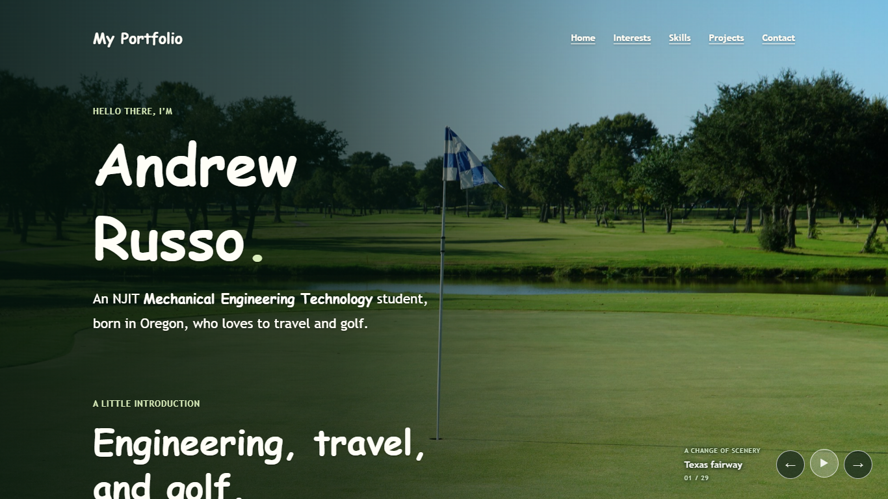

# Portfolio Website Report

Andrew Russo · November 2, 2026

Live website: https://ajr243.github.io/porfolio/ · [Two-page PDF report](REPORT.pdf)

## Website features

My portfolio introduces me as a Mechanical Engineering Technology student at NJIT and presents my experience, interests, skills, and engineering work. The main navigation connects Home, Interests, Skills, Projects, and Contact. A separate About Me page provides another introduction. The Home page includes work experience and extracurricular activities, while the Interests page highlights engineering, travel, and golf.

The Projects page includes seven interactive CAD models. Visitors can rotate, pan, and zoom using a mouse, touch gestures, or keyboard controls. Each viewer includes preset views, automatic rotation, wireframe, fullscreen, and an STL download. Models load as their sections approach the viewport, reducing unnecessary initial loading.

The Contact page separates personal email, NJIT email, phone, and LinkedIn into clearly labeled sections. Email and phone links open the appropriate applications, and a copy-email button provides feedback. A 29-image scenery slideshow includes previous/next and pause/play controls. It respects reduced-motion preferences and stops its timer when the page is hidden. The About Me page also exposes a theme toggle that remembers the selected preference. Responsive layouts and visible keyboard focus support phone and laptop use. GitHub Pages hosts the site.

## Challenges and solutions

Keeping light text readable over changing photographs was a challenge. Live Lighthouse audits initially reported contrast failures on several pages. The underlying page background was pale even though the scenery treatment was dark. I changed the fallback paint to a matching dark green. I also corrected skipped heading levels on Interests and made accessible control names match their visible text.

The 3D viewers needed useful behavior when rendering failed. A test that disabled WebGL found that an error message appeared but the unusable toolbar remained visible: its CSS display rule overrode the HTML hidden attribute. Adding `.cad-toolbar[hidden] { display: none; }` fixed the problem, and the live retest confirmed that the fallback message and download link remained available.

Testing against the deployed site required waiting for GitHub Pages to publish fixes before checking them again. The completed [test plan](TESTING.md) records 46 executed cases covering every page's navigation, phone/laptop layout, keyboard access, JavaScript interactions, and Lighthouse Accessibility. All final cases passed, and all six public pages achieved 100/100 Accessibility with no failed audits. The report distinguishes viewport emulation from physical-device testing.

## A Codex mistake and how it was fixed

Codex's first keyboard-test script treated navigation to the current URL as complete before the browser finished reloading. The next test could then start too early, producing “navigation interrupted” errors even though the site's links worked. I corrected the test script to wait for navigation completion when Enter activated a link. Rerunning the tests on the live site confirmed that every page's navigation and keyboard checks passed. This showed why an automated failure must be investigated before assuming the website is broken.

## Screenshots

Captured from the live GitHub Pages homepage on November 2, 2026, using Chrome. These are browser screenshots with emulated viewports, not photographs of physical devices. The PDF places both screenshots on its second page.

Laptop viewport: 1366 × 768 CSS pixels.

Phone viewport: 390 × 844 CSS pixels. Navigation wraps beneath the portfolio name and the content remains in a single column.

